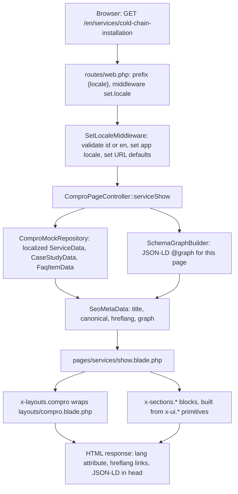

# DEVELOPER GUIDELINE & PROJECT RECAP (`docs/guideline.md`)

> **Purpose:** This is the first file a new developer reads. It explains what this boilerplate is, where everything lives, how a request flows through the code, what is built and what is not, and which document to update when something changes. It is a map, not a source of truth: facts, design tokens, schemas, and procedures live in the four canonical documents it links to. If this file and a canonical document disagree, the canonical document wins and this file must be fixed in the same changeset.

---

## 1. What This Project Is

A bilingual (`id` default, `en`) B2B **service company profile website** (Compro) built as a reusable boilerplate. The sample business is a corporate legal, licensing, and business advisory firm (`Koolom Partners`, `PT Koolom Mitra Konsultan`) modeled on the `koolom.webflow.io` reference layout. All of its data is **seed data** and is labeled as such on screen. The code is meant to be forked for a real business (see Section 12).

| Layer | Choice | Where it is pinned |
| :--- | :--- | :--- |
| Runtime | PHP 8.5, Laravel 13 | `composer.json`, `docs/workflow.md` Step 0.4 |
| Public UI | Pure Blade `<x-*>` components, Tailwind CSS v4, Alpine.js v3 (no React on public pages) | `package.json`, `docs/design.md` Section 4 |
| Admin CMS | Inertia.js v2 + React 19 `.jsx` under `/cms/*` | **Planned, not installed** (Phase 5) |
| Data layer | PHP 8.5 `readonly` DTOs hydrated from a mock repository | `docs/data-contracts.md` |
| Tests and format | Pest 5, Laravel Pint | `composer.json` |

Design principle: **zero hardcoding in Blade**. Business copy comes from DTOs or `lang/*/ui.php`, never from raw strings in views, so the same views can later be fed from Eloquent and a CMS.

---

## 2. Reading Order for a New Developer

1. This file (15 minutes).
2. [`AGENTS.md`](../AGENTS.md): rules every human and AI agent must follow, the verification commands, and the specialist agent personas.
3. [`docs/workflow.md`](workflow.md): the phase-by-phase SOP and the approved package list (Step 0.4).
4. [`docs/data-contracts.md`](data-contracts.md): before touching any DTO, Blade prop, or form field.
5. [`docs/design.md`](design.md): before touching any color, spacing, layout, or page composition.
6. [`docs/knowledge-base.md`](knowledge-base.md): before touching any business fact or copy.
7. `.agents/skills/antislop/SKILL.md` and the sibling `antislop-*` skills: the quality rules (R-01 to R-40) enforced on UI and copy.

---

## 3. Documentation Map & Ownership

| File | Owns | Never put here |
| :--- | :--- | :--- |
| [`AGENTS.md`](../AGENTS.md) | Governance, agent personas, CLI verification commands, template handoff procedure | Business facts, tokens, schemas |
| [`docs/knowledge-base.md`](knowledge-base.md) | Company identity, metrics, certifications, services, case studies, FAQ bank, 301 redirect map | Code structure, styling |
| [`docs/workflow.md`](workflow.md) | Build phases, package matrix, folder hierarchy, localization and SEO procedure, verification gates | Copy, color values, DTO fields |
| [`docs/design.md`](design.md) | Design Read, WCAG contrast table, `@theme` tokens, responsive reflow, route table, page section blueprints | Business facts, DTO fields |
| [`docs/data-contracts.md`](data-contracts.md) | DTO shapes, Blade `@props`, page view data, form validation, cache keys | Colors, workflow steps |
| `docs/guideline.md` (this file) | Onboarding recap, status table, sync matrix, recipes, troubleshooting | Anything a canonical file already owns (link to it instead) |

---

## 4. Implementation Status

Update this table in the same changeset whenever a phase, page, component, route, or package is added or removed.

| Area | Status | Notes |
| :--- | :--- | :--- |
| Phase 0: governance docs | Done | Six documentation files, `.agents/skills/` Antislop and Laravel skills |
| Phase 1: context engineering | Done (seed data) | `docs/knowledge-base.md` holds sample business facts, not a real client |
| Phase 2: assets, Blade hierarchy, DTOs | Done for the public entry | `compro.css` and `compro.js` built. Dual-entry CMS pipeline (`cms.css`, `cms.jsx`) is not built. `vite.config.js` still lists the default `app.css` and `app.js` entries |
| Phase 3: public pages | Done | `home`, `about`, `services` (index, show), `case-studies` (index, show), `contact` in both languages |
| Phase 4.1 JSON-LD graph | Done | `SchemaGraphBuilder`: `Organization`, `LocalBusiness`, `WebSite`, `WebPage`, `BreadcrumbList`, `Service`, `FAQPage` |
| Phase 4.2 bilingual routing | Done | `/{locale}` prefix, `SetLocaleMiddleware`, reciprocal `hreflang` (`id`, `en`, `x-default`), legacy 301 redirects |
| Phase 4.3 on-page SEO and sitemap | Done | `<x-seo.meta>`, canonical, OpenGraph, Twitter, `/sitemap.xml` with `xhtml:link` alternates |
| Phase 4.4 articles and AMP | **Planned** | No `ArticleData`, article routes or views, `AmpSanitizer`, or `layouts/amp.blade.php` |
| Phase 4.5 accessibility | Built, partly verified | Skip link, landmarks, labels, focus trap, theme toggle exist. Manual keyboard and screen-reader audit not performed |
| Phase 5: admin CMS and Eloquent | **Not started** | No Inertia, React, Spatie packages, migrations beyond Laravel defaults, or `/cms` routes |
| Phase 6: delivery gate | Automated checks pass | Pest, Pint, and `npm run build` pass. Lighthouse and Web Vitals **not measured**. Manual click-through (R-35) not performed |

**Known limitations (do not assume these work):**
- `POST /{locale}/inquiries` validates and returns a reference code (`RFQ-YYYYMMDD-XXXX`) but **does not persist the inquiry or send email**. Wire storage or mail before launch.
- All content comes from `app/Data/Mocks/ComproMockRepository.php`. There is no database content yet.
- Images are SVG schematic placeholders in `public/images/placeholders/`, flagged `isPlaceholder`.
- No sitemap or page cache. Each request rebuilds DTOs (cheap for the mock repository).
- `APP_LOCALE` in `.env.example` is `en`, but `/` redirects to `/id`. The URL prefix, not `APP_LOCALE`, decides the language.
- `docs/design.md`, `resources/css/compro.css`, and public Blade section templates have been fully updated to the `koolom.webflow.io` Bento layout and the **White (Primary) + Blue (Secondary) + Orange (Tertiary)** triadic color spectrum.

Last automated verification: 2026-11-04, `php artisan test --compact` (20 tests, 114 assertions passing), `vendor/bin/pint --format agent` passing, `npm run build` passing.

---

## 5. Project Map

```text
AGENTS.md                         Governance, agents, verification commands
docs/                             The five documentation files (Section 3, plus AGENTS.md at the root)
.agents/skills/                   Antislop and Laravel skills (read before UI, copy, tests)

app/
  Data/
    Shared/                       SeoMetaData, MediaAssetData, ActionLinkData, MetricProofData, CertificationData
    CompanySettingsData.php       Identity, contacts, metrics, certifications
    ServiceData.php               One service (SRV-xx) with specs and workflow steps
    CaseStudyData.php             One project dossier (CS-xx)
    FaqItemData.php               One FAQ entry
    TestimonialData.php           Empty until verified real quotes exist (R-18)
    HomePageData.php              Everything the home page needs
    Mocks/ComproMockRepository.php  Localized seed data (id and en). Swap for Eloquent in Phase 5
  Http/
    Controllers/ComproPageController.php   All public pages, RFQ submit, sitemap, legacy redirect
    Middleware/SetLocaleMiddleware.php     Validates {locale}, sets app locale and URL defaults
    Requests/StoreInquiryRequest.php       RFQ validation, localized messages, honeypot
  Services/
    SchemaGraphBuilder.php        Builds the JSON-LD @graph
    SitemapGenerator.php          Builds sitemap entries with hreflang alternates

routes/web.php                    Locale-prefixed route pairs (id and en slugs), legacy 301s, sitemap
lang/{id,en}/ui.php               All static UI chrome strings (nav, form labels, section labels)

resources/
  css/compro.css                  Tailwind v4 @theme tokens, dark overrides, base interaction affordances
  js/compro.js                    Alpine setup: comproShell (theme, mobile menu), rfqForm (4-state form)
  views/
    layouts/compro.blade.php      The real page shell (head, skip link, header, footer)
    components/layouts/compro.blade.php   Thin wrapper so pages can write <x-layouts.compro>
    components/seo/meta.blade.php         <x-seo.meta> head tags and JSON-LD push
    components/ui/                Primitives: button, badge, container, section-header, image, empty-state, alert
    components/sections/          hero-split, proof-ledger, service-matrix, process-timeline,
                                  case-study-showcase, technical-faq, rfq-cta-banner
    pages/                        home, about, contact, services/{index,show}, case-studies/{index,show}
    seo/sitemap.blade.php         XML sitemap view
    welcome.blade.php             Laravel default, unused (handoff cleanup target)

public/images/placeholders/       SVG schematic placeholders (replace with real photos)
tests/Feature/ComproLandingPageTest.php   Pages, SEO, schema, RFQ, sitemap, redirects
tests/Feature/ExampleTest.php             Root redirect check
```

---

## 6. How a Request Flows



Key points:
- The locale comes only from the URL prefix. Slugs differ per language (`/id/layanan/...` vs `/en/services/...`), so routes are declared in pairs with names ending `.id` and `.en`.
- DTOs hold the **already resolved** string for the active locale. Blade never looks up translations for domain content.
- Static UI chrome (navigation, labels, buttons) uses `__('ui.*')` from `lang/{locale}/ui.php`.
- Every controller method builds a `SeoMetaData` (title, description, canonical, alternates, schema graph) and the layout renders it through `<x-seo.meta>`.
- Canonical URLs and the sitemap use `config('app.url')`. **Set `APP_URL` to the real domain** or canonical and hreflang values will be wrong.

---

## 7. Local Setup & Daily Commands

First-time setup:

```powershell
composer install
copy .env.example .env
php artisan key:generate
npm install
npm run build
```

(`composer run setup` performs the same steps and also runs migrations.)

| Task | Command |
| :--- | :--- |
| Dev server with hot reload | `composer run dev` (or `php artisan serve` plus `npm run dev`) |
| Run all tests | `php artisan test --compact` |
| Run one test file or filter | `php artisan test --compact tests/Feature/ComproLandingPageTest.php` or `--filter=name` |
| Format PHP | `vendor/bin/pint --dirty --format agent` (needs Git) or `vendor/bin/pint --format agent` |
| Production asset build | `npm run build` |
| List public routes | `php artisan route:list --except-vendor` |
| Clear compiled views and caches | `php artisan optimize:clear` |
| Contrast check | `python .agents/skills/antislop-human/contrast-check.py "#HEX_BG" "#HEX_FG"` |

**Windows / Laragon troubleshooting**
- If `php -v` does not report 8.5, call the project binary directly, for example `C:\laragon\bin\php\php-8.5.12-1-nts-Win32-vs17-x64\php.exe artisan test --compact`. Adjust the folder to your installed version.
- `vendor/bin/pint --dirty` fails with "only available when using Git" until the folder is a Git repository. Use `vendor/bin/pint --format agent` instead.
- "Unable to locate file in Vite manifest" or missing styles: run `npm run build`, or keep `npm run dev` running.
- A view change does not appear: run `php artisan view:clear`.
- Wrong canonical or hreflang host in the page source: fix `APP_URL` in `.env`, then `php artisan config:clear`.

---

## 8. Bilingual System (id and en)

| Content type | Where it lives | Example |
| :--- | :--- | :--- |
| Navigation, buttons, form labels, section labels | `lang/id/ui.php` and `lang/en/ui.php` (keep keys identical in both files) | `__('ui.nav.services')` |
| Business content (services, case studies, FAQs, metrics) | Localized arrays in `ComproMockRepository`, later localized DB columns | `$service->title` |
| Page titles and meta descriptions | Built per locale in the controller or repository | `SeoMetaData` |
| Validation messages | `StoreInquiryRequest::messages()` (both languages) | `work_email.email` |
| URLs | Route pairs in `routes/web.php` with separate `id` and `en` slugs | `/id/layanan` and `/en/services` |

Rules: never ship a page in one language only, keep `hreflang` alternates reciprocal, and never put a translation string inside a view that belongs in a DTO or `ui.php`.

---

## 9. Recipes (What to Change and What to Update)

**Add a service**
1. Record it in `docs/knowledge-base.md` Section 4 (both languages, real stage count).
2. Add the record to `ComproMockRepository::getServices()` (both locales, slugs, specs, workflow steps, CTA label).
3. Add its `SRV-xx` code to the `service_code` rule in `StoreInquiryRequest` and the RFQ fallback options.
4. Add a placeholder or real image and update the sitemap expectations in tests.
5. Update `docs/data-contracts.md` Section 4.1 if the allowed codes changed.

**Add a section component**
1. Add `resources/views/components/sections/<name>.blade.php` with explicit `@props` and an empty-state branch (R-27, R-38).
2. Document its props and empty behavior in `docs/data-contracts.md` Section 5 and its layout in `docs/design.md` Section 6.2.
3. Add the new row to `docs/workflow.md` Step 2.2 and to the project map above.

**Add a page**
1. Add the localized route pair in `routes/web.php`, a controller method that builds `SeoMetaData`, and the view in `resources/views/pages/`.
2. Add it to `SitemapGenerator`, the header and footer links in `layouts/compro.blade.php` (no link to an unbuilt page, R-24), and a test case.
3. Update `docs/design.md` Section 6.1 (route table), `docs/data-contracts.md` Section 5.2 (view data), and this file's status table and project map.

**Change brand colors or fonts**
1. Edit the tokens in `resources/css/compro.css`.
2. Re-run `contrast-check.py` for every text, surface, and border pair, and update the table in `docs/design.md` Section 3 and the token block in Section 4.

**Add or change an RFQ form field**
1. Update `docs/data-contracts.md` Section 4.1 first.
2. Change `StoreInquiryRequest` (rules and both message sets), the form in `rfq-cta-banner.blade.php` (visible `<label for>`, error element, `aria-describedby`), the `rfqForm` state in `compro.js`, `lang/*/ui.php` labels, and the tests.

**Change a business fact**
1. Edit `docs/knowledge-base.md` first.
2. Mirror it in `ComproMockRepository` and any `lang/*/ui.php` string that repeats it. Never invent unverified numbers (R-17, R-36, R-38).

---

## 10. Change-to-Document Sync Matrix

| If you change... | Update in the same changeset |
| :--- | :--- |
| Company facts, services, case studies, FAQs, contacts, redirects | `docs/knowledge-base.md`, then the mock repository and `lang/*/ui.php` |
| A DTO property, Blade `@props`, controller view data, form field, validation rule, cache key | `docs/data-contracts.md` |
| Color token, font, spacing, breakpoint, layout rhythm, nav, page section order, route table | `docs/design.md` (and contrast table if colors changed) |
| Build pipeline, folder structure, package, localization or SEO procedure, verification command | `docs/workflow.md` |
| A phase started or finished, page or component added or removed, command or environment requirement, known limitation | `docs/guideline.md` (status table, project map, limitations) |
| Governance rule, agent persona, handoff inventory | `AGENTS.md` |
| Anything above that a new developer would trip over | `docs/guideline.md` as well |

Before closing a task, search `docs/` for the old name, path, route, or count you changed, and fix every hit.

---

## 11. Quality Guardrails (Summary)

Full rules are in `.agents/skills/antislop*/SKILL.md`. The ones that break builds most often:
- **No em dashes** in copy, comments, or docs (R-02). Tests assert none appear in rendered HTML.
- **No dead links or ghost features** (R-24, R-26): every nav and CTA target must exist.
- **Honest data** (R-16, R-17, R-18, R-36, R-38): no invented clients, testimonials, logos, or metrics. Unverified data is an empty collection, and seed data stays labeled.
- **Accessibility** (R-32, R-39): skip link, landmarks, one `<h1>`, visible `<label for>`, text-based errors, `:focus-visible`, 44px targets, native `<button>` and `<a href>`.
- **Performance** (R-40): explicit `width` and `height` on media, only the hero image uses `priority`, no render-blocking third-party scripts, never claim a score that was not measured.
- **Dependencies**: do not add packages without approval. The approved list and the deferred Phase 5 packages are in `docs/workflow.md` Step 0.4.

---

## 12. Forking This Boilerplate for a Real Business

Do not hand-delete files. Invoke `@Template-Handoff-Cleaner` (defined in `AGENTS.md` Section 3). It collects the real business facts first, shows a dry-run list of every file and string to remove or replace, waits for approval, executes, syncs all six docs, and ends with the leftover scan. The onboarding checklist is `docs/workflow.md` Step 0.3. Never run it on this master template repository.

---

## 13. Keeping This File Accurate

- Treat it like code: any pull request that changes structure, routes, components, commands, or status edits this file.
- Keep it a map. When detail already lives in a canonical document, link to it instead of copying it.
- Replace the "Last automated verification" line only after actually re-running the three commands.